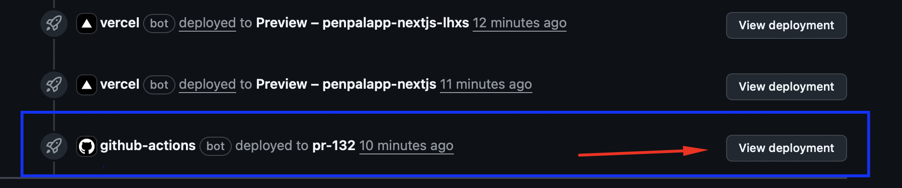

# Deployment (short)

Preview URL appears in the PR deployment card.
CI/CD recipe: `.github/workflows/ci-deploy.yml`.

## Server error analytics

Set `GA_MEASUREMENT_ID` to the Firebase web stream's GA4 measurement ID and
`GA_API_SECRET` to a Measurement Protocol API secret created for that same
stream. Configure each deployment environment with the matching stream and keep
the secret server-side (do not use a `NEXT_PUBLIC_` prefix). Without both
variables, errors are still written to server logs and a warning is emitted.

Server error events have a generated client ID and, when available, a verified
Firebase UID as GA4 `user_id`. They are not associated with a browser session.
Use `error_event_id` to correlate an event with the full error in server logs;
GA receives no error text or arbitrary context. Protect access to these logs and
apply appropriate retention because error details may contain sensitive data.
Measurement Protocol's successful HTTP response only confirms receipt, not
that GA4 processed the event. Use its validation endpoint when configuring a
new stream. Firebase Admin initialization is synchronous, so its best-effort
analytics request cannot be awaited during module initialization; the server
log is the reliable record for those failures.
